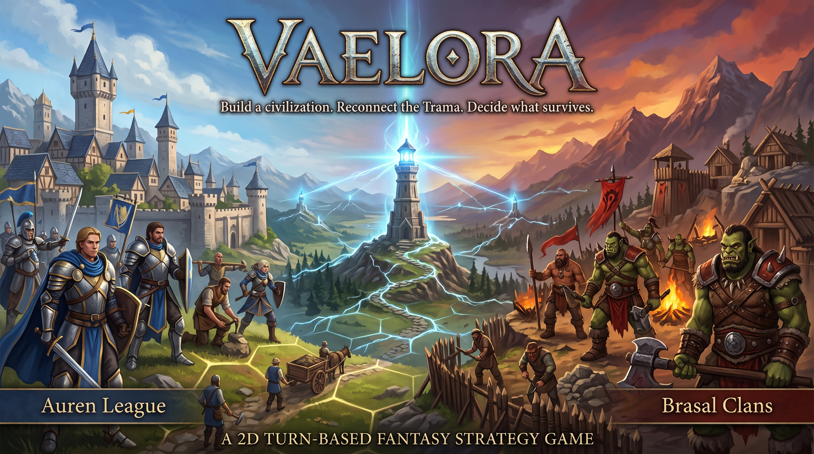

# Vaelora

> **Build a civilization. Reconnect the Trama. Decide what survives.**



> **Visual foundation:** the supplied key art establishes the current reference for Vaelora's bright, luminous fantasy direction, the contrast between its prototype civilizations, and the Trama as a visible connection across the world. It is a project reference, not implemented game UI.

Vaelora is a 2D, turn-based fantasy strategy game in preproduction. You explore a seeded hexagonal world, found and develop cities, claim and improve territory, research technologies, connect settlements with roads, and compete against an AI rival.

The game is set on the continent of Vaelora, where generations of political disputes and neglected infrastructure have weakened **the Trama**: an old network of roads and signal beacons. The human **Auren League** and the orc **Brasal clans** are the first civilizations competing to restore, control, or replace it.

> **Current status:** the design and repository foundation are complete enough to begin the Godot project. Gameplay implementation, assets, and automated game tests have not started yet. The first prototype must use final-quality visual assets; placeholder art is out of scope.

> **Rights:** Vaelora's original materials are proprietary and all rights are reserved by Iván de Paz Delgado. See [LICENSE](LICENSE). This public repository can still be viewed and forked through GitHub's platform permissions; the notice does not grant broader reuse rights.

## At a glance

| Area | Direction |
|---|---|
| Genre | Accessible turn-based fantasy strategy |
| Players | Local single-player against one AI opponent initially |
| World | Procedurally generated, seeded hex map with fixed-isometric 2D presentation |
| Map types | Continents, Inland Sea, and Archipelago |
| Map sizes | 48×32, 64×40, and 80×50 hexes |
| Platforms | Android, Windows, macOS, Linux, and Web are planned targets |
| Engine | Godot with GDScript |
| Prototype civilizations | Human Auren League and orc Brasal clans |
| Match modes | Turn-limited score, total conquest, full-tree knowledge, and combined victory |
| Visual direction | Bright, luminous, readable fantasy art in landscape orientation |

## The core loop

1. **Prepare** — choose a civilization, match mode, map type and size, and difficulty. The AI opponent and seed are selected automatically; the seed is visible and saved.
2. **Explore** — move settlers, workers, explorers, and soldiers through fog of war while reading terrain, resources, and strategic routes.
3. **Establish** — found cities, assign contiguous territory, and grow each city up to level 6.
4. **Develop** — improve meadows, forests, hills, and coasts with limited-use workers; choose one unit or building production project per city.
5. **Connect** — build roads between settlements to improve movement and increase connected-city income and growth.
6. **Research** — advance through a shared technology tree while each civilization develops a small number of unique technologies.
7. **Compete** — fight deterministic land and naval engagements, capture cities, and pursue the selected victory condition.

Each turn follows the same readable rhythm: the human issues validated commands, confirms the plan, ends the turn, and then the AI takes its own turn. Production, growth, income, and research resolve at the civilization turn boundary.

## Design pillars

- **Readable strategy:** clear hex movement, previews, deterministic combat, and a shared action vocabulary across touch, mouse, keyboard, and controller.
- **Cities as decisions:** every city is an active economic, production, research, and territorial choice rather than a passive score marker.
- **Meaningful geography:** terrain affects yields, movement, defense, visibility, settlement opportunity, and the value of roads and ports.
- **Fair asymmetry:** map generation is not mirrored, but starting regions are evaluated for separation, workable territory, and comparable opportunity.
- **Human-readable competition:** the AI follows the same command validation and visibility rules as the player; difficulty changes planning horizon and starting economy, not hidden information or free units.
- **Deterministic foundations:** seeds, saves, combat resolution, turn boundaries, and migrations are designed to be reproducible and testable.

## First prototype boundary

The first complete prototype is a two-civilization game, not a reduced rules demo. It includes the agreed initial match modes and the full baseline systems for both prototype civilizations:

- seeded map generation and fog of war;
- cities, territory claims, growth, income, production, and capture;
- workers, terrain improvements, ports, and roads;
- shared research plus civilization-specific technologies;
- land combat, naval transport, and patrol ships;
- AI difficulty, save/load, autosave, input, accessibility, and victory scoring.

The remaining four planned civilizations are out of the first prototype and will only be considered after the two-civilization prototype passes its final test battery. Online multiplayer, campaign progression, city renaming, and additional initial combat classes are also out of scope.

## Documentation map

Start with the [documentation index](docs/README.md), then use the document that matches your task.

### Product and game design

- [Product vision and scope](docs/product/vision-and-scope.md) — audience, goals, constraints, and non-goals.
- [Game Design Document](docs/game-design/game-design-document.md) — canonical gameplay baseline and system rules.
- [World and civilizations](docs/game-design/world-and-civilizations.md) — Vaelora, the Trama, and civilization direction.
- [Open design decisions](docs/game-design/open-decisions.md) — unresolved questions and balance values that still need decisions.

### Engineering and delivery

- [Technical architecture proposal](docs/technical/architecture-proposal.md) — proposed Godot structure, simulation boundaries, saves, input, and platform validation.
- [Production plan](docs/production/production-plan.md) — phases, prototype scope, and quality gates.
- [Development workflow](docs/project/development-workflow.md) — the only supported branch, issue, PR, and promotion flow.
- [GitHub readiness](docs/project/github-readiness.md) — verified repository settings and remaining setup decisions.
- [Contributing guide](.github/CONTRIBUTING.md) — the short contributor entry point.

## Contribution flow

Vaelora uses a strict two-stage promotion model:

```text
feature/<issue>-<slug>  ──PR + GitGuardian + review──▶  dev
dev                     ──integration review + PR────▶  main
```

- Every feature, fix, or documentation change starts with a concrete GitHub issue and uses a short-lived `feature/<issue>-<slug>` branch from `dev`.
- Feature PRs target `dev`, link their issue, and use `Closes #N` when the work is complete. The issue closes only after the PR is merged and the required checks pass, including GitGuardian.
- `main` receives changes only through a promotion PR created from `dev`. That PR does not need an intermediate issue.
- Direct pushes, feature-to-`main` PRs, and direct merges from `main` back into `dev` are not part of the normal flow.
- Before promotion, the integrated `dev` branch receives a technical and documentation review. A blocker is corrected through another feature PR to `dev`.

Commits use [Conventional Commits](https://www.conventionalcommits.org/en/v1.0.0/). Do not add credentials, private data, `Co-Authored-By`, or AI attribution to repository artifacts.

## Start here

- **Learning the project:** read [Product vision and scope](docs/product/vision-and-scope.md), then the [Game Design Document](docs/game-design/game-design-document.md).
- **Planning implementation:** read [Open design decisions](docs/game-design/open-decisions.md) and the [Technical architecture proposal](docs/technical/architecture-proposal.md).
- **Proposing work:** search open and closed issues, create the matching issue, then follow the [development workflow](docs/project/development-workflow.md).
- **Checking repository state:** consult [GitHub readiness](docs/project/github-readiness.md) before changing branch rules, labels, templates, or CI.
