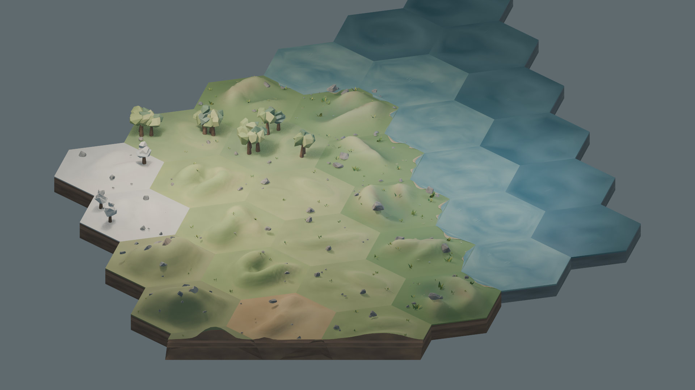
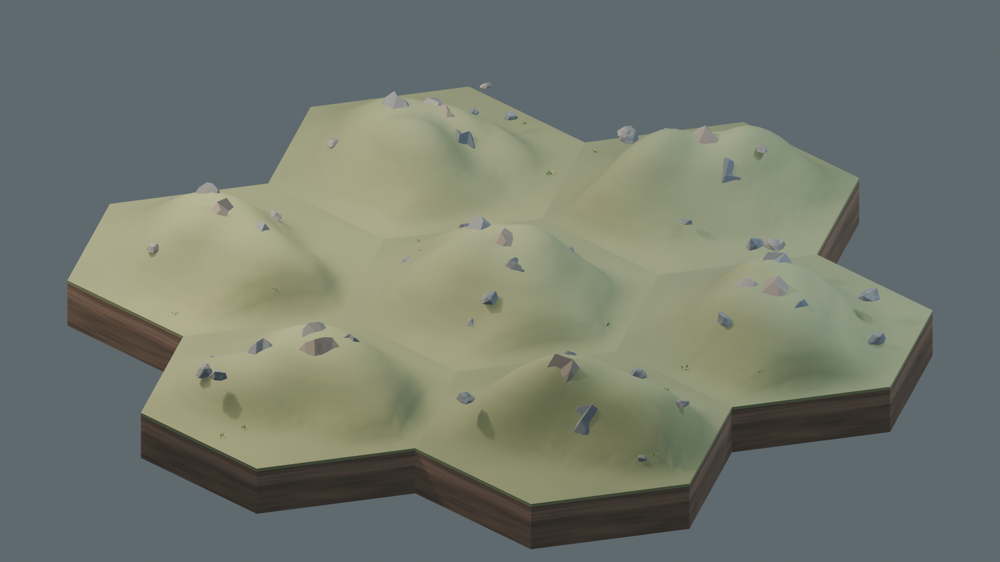
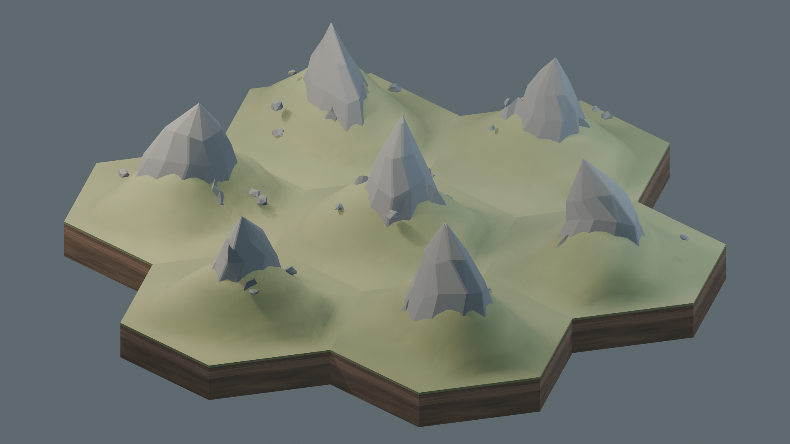

# Terrain Visual Language v1 — Closure Record

**Decision:** the terrain *visual language* is closed at the approved Terrain Suite `v6.2-rc1` candidate. This is an art-direction baseline, not a claim that production sprites have been exported, integrated into Godot, or that issue #17 and the full prototype visual gate are complete.

**Decision provenance:** the project owner requested this closure on 2026-11-03 after reviewing the Mountain, Peak, and 36-hex suite images. The source and host-side contract are in this repository; the visual judgment is a human decision, not a test result. No numeric scorecard for the v6.2 renders is recorded here.

## Scope and authority

This record closes the shared terrain-family appearance and construction grammar. The [Art Bible](visual-art-bible.md) remains the overall identity contract; [Shape Language](visual-shape-language.md) owns modelling rules; [Composition Language](visual-composition-language.md) owns placement and negative space; the [Art Pipeline](art-production-pipeline.md) owns production and export; the [Quality Gate](visual-quality-gate.md) owns later asset and integrated-slice acceptance. Gameplay terrain rules remain in the [GDD](game-design-document.md); a visual family is not automatically a new playable terrain category.

The v1 visual suite has **ten families**: Water, Coast, Meadow, Plains, Hills, Forest, Desert, Snow, Mountain, and Peak. The initial prototype's **nine gameplay terrain categories** remain unchanged. In particular, Desert and Snow in this visual suite do not, by themselves, authorize new gameplay terrain types or a seasonal system.

## Locked principles

- **Camera and projection:** one orthographic master camera at 45° yaw and 30° elevation, fixed 2:1 dimetric presentation; no per-asset camera fixes.
- **Authoring and runtime:** Blender 5.2.3 LTS is the production authoring/render pin. Godot uses composited 2D transparent PNG sprites and overlays, not runtime 3D terrain.
- **Library:** deterministic seeds select from an authored, finite variant library. A benchmark may not rely on geometry unavailable to the eventual runtime exports.
- **Composition:** the terrain mass and silhouette carry identity; scatter is deliberately reduced, grouped, grounded on the sculpted surface, and edge-aware. Six-edge registration, protected attachment space, and repetition readability remain mandatory.
- **Identity:** category recognition at strategy scale outranks isolated beauty. Geography remains civilization-neutral; roads, improvements, units, cities, fog, and selection are separate layers.

## Final family baseline

| Family | v1 disposition |
|---|---|
| Meadow | Frozen from `v6.1-rc1`; sculpted fertile green mass with curated sparse detail. |
| Plains | Frozen from `v6.1-rc1`; open directional swells and restrained surface life. |
| Forest | Frozen from `v6.1-rc1`; grouped canopy and readable ground/negative space. |
| Hills | Frozen from `v6.1-rc1`; broad directional crests and saddles, not a single bump. |
| Desert | Frozen from `v6.1-rc1`; arid sculpted form, warm geology, sparse dry growth. |
| Snow | Frozen from `v6.1-rc1`; cold drifts and rock, not a white recolor. |
| Water | Frozen from `v6.1-rc1`; broad depth fields and quiet restrained glints. |
| Coast | Frozen from `v6.1-rc1`; organic shoreline on the established topology, with reduced visual amplitude. |
| Mountain | Final `v6.2-rc1` polish: the terrain itself is the mountain; 3–5 broken, separated outcrops are visibly embedded in the slope, with terrain visible between them. No continuous stone rib, floating plate, cone, or radial starburst. |
| Peak | Final `v6.2-rc1` polish: an asymmetric integrated summit on the mountain foundation, never a needle/obelisk. Four distinguishable archetypes: `alpine_offset`, `broken_summit`, `twin_shoulder`, `escarpment`. |

`v6.2-rc1` changes **Mountain and Peak only**. The other eight families, including Coast, delegate to the `v6.1-rc1` behavior; `v6.0`, `v6.1`, `v5`, and `v0.3.x` remain historical implementation/review milestones, not the current terrain-v1 visual decision. This closure does not erase their tests or provenance.

## Acceptance criteria and observed evidence

The external `TERRAIN-SUITE-V62-ACCEPTANCE.md` brief is not a stable repository dependency. Its visual criteria are retained here so the decision can be read without that package: Mountain must have no floating-rock read, terrain-led mass, separated embedded geology and strategy-scale identity; Peak must read first as mountain and second as summit, with four distinct integrated archetypes and no needle/obelisk. The 36-hex board must remain cohesive and frozen families must not regress. The brief's numerical targets are Mountain ≥8.7, Peak ≥8.5 and benchmark36 ≥9.0; **no recorded per-family numerical scoring is available in this repository**, so this record does not assert those numbers were measured.

| Check | Observed state at closure |
|---|---|
| Human visual direction | Project owner states Mountain and Peak `v6.2-rc1` are approved for v1 closure. |
| Host-side invariants | `test_contract.py`, `test_terrain_suite_v6.py`, `test_terrain_suite_v61.py`, and `test_terrain_suite_v62.py` passed on 2026-11-03. The v6.2 test checks the 36-cell benchmark, 3–5 Mountain fragment target, four Peak archetypes, no legacy spire call, and frozen-family delegation. |
| Source-context images | Three `v6.2` `.blend`/PNG review pairs exist for Mountain, Peak, and benchmark36 under `game/assets/terrain/generated-terrain-suite-v62/review/`. |
| Production PNG/manifest/QA | No v6.2 `final_2x` exports, manifests, or `qa-terrain-suite-v62` report were found at closure. |
| Runtime acceptance | No v6.2 Godot 2D composition evidence was found; the full issue-17 premium lock is **not** claimed. |

### Review renders

These are the approved suite's Blender source-context review images. They help document the visual decision, but are not final 2D runtime sprites.

**Benchmark36 — family cohesion and terrain transitions**

**Mountain — embedded, separated geological outcrops**

**Peak — asymmetric summit archetypes on the mountain foundation**

## Production pipeline and naming

Use the accepted visual baseline as input to the existing reproducible pipeline: semantic brief → deterministic Blender source on the 5.2.3 LTS pin → 4× render → premultiplied-alpha Lanczos downsample → final 2× transparent PNG/manifest → automated image and provenance QA → contextual sheets → Godot import/runtime captures → human asset acceptance. Preserve source hashes, seed, family, authored variant, camera, Blender version, postprocess, and QA state in the manifest. The working candidate identifier is `terrain-suite-v62` / `6.2-rc1`; the decision name is **Terrain Visual Language v1**. Do not rename historical candidate folders or label a review PNG `final_2x` without the export gates.

Production asset names should encode family, authored variant, and (for directional overlays) world edge; the exact filename/schema remains owned by the pipeline and manifest contract. Coast's finite shoreline vocabulary is **3 semantic morphologies × 2 authored variants × 6 directions = 36 reusable edge overlays**, separate from the terrain-suite candidate's six Coast review variants. A tile selects one authored variant deterministically and reuses it on all sea-facing edges; neighbor-mask combinations are not baked as unique sprites.

## QA gates still open

Before calling individual sprites accepted or issue #17 complete, produce/export the finite v1 assets and run the existing [quality gate](visual-quality-gate.md): source/manifest and image checks, isolated and repetition sheets, color/grayscale, 75/100/125% gameplay-scale views, 320 px proxy, fixed-seed coast stress, actual Godot 2D board captures with accepted PNGs, import/memory evidence, and explicit human acceptance. The broader premium lock also requires its own human-entered scorecard (each area ≥9.0, mean ≥9.3, zero Blocker/Major), cities and soldiers, and runtime fidelity. Passing host-side v6.2 invariants or viewing Blender renders does not satisfy these later gates.

## Frozen versus out of scope

**Frozen for terrain v1:** the ten visual family identities, shared camera/projection, authored finite-library approach, deterministic seeds, reduced edge-aware scatter, exact tile registration, and the `v6.2-rc1` Mountain/Peak forms. A later change needs a new, explicitly reviewed visual revision rather than a silent edit to this baseline.

**Not closed by this decision:** exported production sprites, Godot integration, platform/performance proof, issue #17's integrated visual slice, gameplay category changes, faction/city/unit art, roads/improvements, UI, VFX, marketing art, seasonal variants, or a whole-game visual lock.

## Next visual blocks

Complete the terrain export/runtime evidence first, then continue the [visual roadmap](prototype-visual-roadmap.md): modular roads and improvements, faction cities, units and facings, fog/territory/interaction overlays, UI/iconography, VFX, and the integrated Godot visual slice. Apply the same camera, palette, readability, provenance, and acceptance discipline without treating terrain-v1 closure as approval of those separate families.
